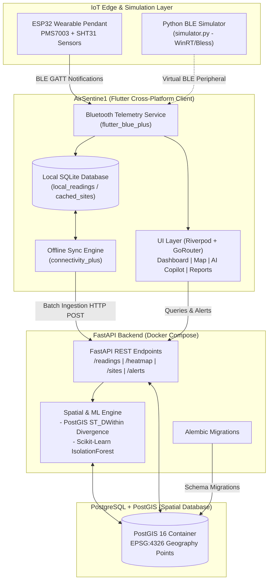
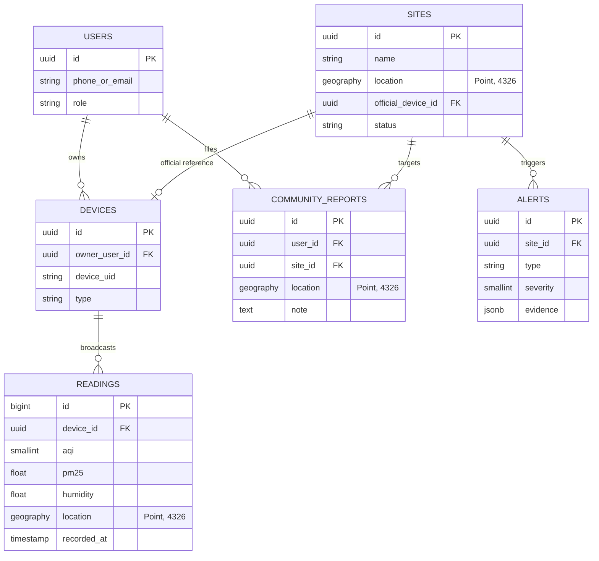

# AirSentinel (IPD_AQI) 🍃

> **Next-Generation Community & Personal Air Quality Monitoring, Spatial Analytics, and Health Telemetry Platform**  
> Tailored for the **Central Pollution Control Board (CPCB) India** air quality standards, featuring wearable ESP32 IoT nodes, crowd-sourced micro-climate divergence detection, machine learning anomaly scoring, offline-first edge caching, and an AI Health Copilot.

---

[](https://fastapi.tiangolo.com)
[](https://postgis.net/)
[](https://flutter.dev)
[](https://www.docker.com/)
[](https://www.python.org/)
[](LICENSE)

---

## 📋 Table of Contents

- [Overview](#-overview)
- [System Architecture](#-system-architecture)
- [Repository Structure](#-repository-structure)
- [Key Features](#-key-features)
  - [1. Mobile & Web Application (`airsentine1`)](#1-mobile--web-application-airsentine1)
  - [2. Spatial Divergence & Anomaly ML Engine](#2-spatial-divergence--anomaly-ml-engine)
  - [3. Offline-First Synchronization Architecture](#3-offline-first-synchronization-architecture)
  - [4. BLE Hardware Protocol & Wearable Pendant](#4-ble-hardware-protocol--wearable-pendant)
  - [5. Python BLE GATT Simulator](#5-python-ble-gatt-simulator)
- [CPCB Air Quality Standard Reference](#-cpcb-air-quality-standard-reference)
- [REST API Reference](#-rest-api-reference)
- [Database Schema & Spatial Storage](#-database-schema--spatial-storage)
- [Getting Started & Installation](#-getting-started--installation)
  - [Prerequisites](#prerequisites)
  - [Step 1: Backend Setup (Docker & PostGIS)](#step-1-backend-setup-docker--postgis)
  - [Step 2: Database Migrations (Alembic)](#step-2-database-migrations-alembic)
  - [Step 3: BLE Simulator Setup](#step-3-ble-simulator-setup)
  - [Step 4: Flutter Application Launch](#step-4-flutter-application-launch)
- [Testing & Quality Assurance](#-testing--quality-assurance)
- [Configuration & Environment Variables](#-configuration--environment-variables)
- [Contributing & License](#-contributing--license)

---

## 🌟 Overview

Air pollution is characterized by extreme micro-spatial variations. Two locations merely a few hundred meters apart can record vastly divergent Air Quality Index (AQI) values due to hyper-local factors: traffic bottlenecks, construction activity, hyper-local biomass burning, industrial exhausts, or street canyons. Official government continuous monitoring stations (CPCB) are spaced kilometers apart and fail to capture hyper-local exposure risks for pedestrians, cyclists, children, and elderly residents.

**AirSentinel (IPD_AQI)** solves this problem with an end-to-end IoT, spatial telemetry, and predictive health platform:
1. **Wearable & Edge IoT Telemetry**: Compact ESP32 hardware pendants collect real-time particulate matter (PM2.5, PM10), humidity, and ambient temperature, streaming data over Bluetooth Low Energy (BLE).
2. **Spatial Divergence Detection**: Compares community sensor data against government monitoring stations within a 300-meter radius to detect micro-climate deviations.
3. **Machine Learning Anomaly Detection**: Employs an Isolation Forest algorithm over continuous rolling time-series telemetry to detect sensor failures or pollution spikes.
4. **Offline-First Synchronization**: Caches telemetry and reports locally in SQLite, syncing automatically with the FastAPI + PostGIS cloud backend upon network reconnection.
5. **AI Health Copilot**: An interactive AI advisor providing CPCB-aligned medical guidance (N95 respirator use, asthma management, outdoor fitness alerts).

---

## 🏗 System Architecture



---

## 📂 Repository Structure

```
IPD_AQI/
├── README.md                      # Comprehensive project documentation
├── requirements.txt               # Dependencies for BLE simulator (WinRT, bless, bleak)
├── simulator.py                   # Python BLE GATT peripheral & mock simulator
│
├── backend/                       # FastAPI + PostGIS backend service
│   ├── Dockerfile                 # Container image specification for FastAPI
│   ├── docker-compose.yml         # Multi-container orchestration (PostGIS 16 + FastAPI)
│   ├── requirements.txt           # Python backend dependencies
│   ├── alembic.ini                # Alembic migration configuration
│   ├── README.md                  # Dedicated backend service documentation
│   ├── .env.example               # Environment variables template
│   │
│   ├── alembic/                   # Database migration versions
│   │   ├── env.py                 # Async migration engine setup
│   │   └── versions/              # Migration scripts (tables: users, devices, readings, sites, etc.)
│   │
│   ├── app/                       # Core FastAPI application
│   │   ├── main.py                # App entrypoint, CORS middleware, API router mounting
│   │   ├── core/                  # Application configuration & Pydantic settings
│   │   ├── db/                    # SQLAlchemy async engine, sessionmaker & get_db dependency
│   │   ├── models/                # SQLAlchemy ORM models (GeoAlchemy2 Geography points)
│   │   │   ├── alert.py           # Anomaly and divergence alert records
│   │   │   ├── community_report.py# Crowd-sourced user field reports
│   │   │   ├── device.py          # Registered hardware & simulator devices
│   │   │   ├── reading.py         # Spatial sensor telemetry readings
│   │   │   ├── site.py            # Official monitoring stations (CPCB)
│   │   │   └── user.py            # Platform user profiles
│   │   ├── schemas/               # Pydantic v2 validation and serialization schemas
│   │   │   ├── alert.py           # Alert creation, response, and trigger payloads
│   │   │   ├── heatmap.py         # Spatial heatmap point schemas
│   │   │   ├── reading.py         # Batch reading ingestion schemas
│   │   │   ├── site.py            # Site details & historical timeseries schemas
│   │   │   ├── telemetry.py       # Personal exposure upload schemas
│   │   │   └── user.py            # Authentication & profile schemas
│   │   ├── api/routes/            # REST API route handlers
│   │   │   ├── alerts.py          # Alert triggering and query routes
│   │   │   ├── auth.py            # Registration, login, and token generation
│   │   │   ├── health.py          # Liveness and readiness healthchecks
│   │   │   ├── heatmap.py         # Spatial bounding-box aggregated heatmap
│   │   │   ├── readings.py        # High-throughput batch readings ingestion
│   │   │   ├── sites.py           # Station history queries
│   │   │   └── telemetry.py       # Personal exposure telemetry endpoints
│   │   └── services/              # Business logic
│   │       └── spatial_engine.py  # Spatial divergence calculator & IsolationForest anomaly detector
│   │
│   └── tests/                     # Automated backend test suite
│       ├── test_alerts_api.py     # FastAPI TestClient endpoint integration tests
│       └── test_spatial_engine.py # Spatial logic & IsolationForest unit tests
│
└── airsentine1/                   # Cross-platform Flutter client application
    ├── pubspec.yaml               # Flutter package configuration & dependencies
    ├── analysis_options.yaml      # Dart static analysis configuration
    │
    ├── lib/                       # Flutter source code
    │   ├── main.dart              # Application bootstrap & ProviderScope initialization
    │   ├── app/                   # App root widget, routing (GoRouter), and responsive scaffolds
    │   ├── core/                  # Design tokens, CPCB AQI utility engine, theme definitions
    │   ├── data/                  # Repositories, local SQLite database, and CPCB seed dataset
    │   ├── models/                # Client domain data models
    │   ├── providers/             # Riverpod state notifiers (telemetry, auth, app state)
    │   ├── services/              # API client, BLE scanner, sync engine, local preferences
    │   ├── widgets/               # Reusable UI components (gauges, weather strips, charts)
    │   └── features/              # Feature modules:
    │       ├── ai_assistant/      # Floating AI Health Copilot popup modal
    │       ├── auth/              # Login & registration screens
    │       ├── dashboard/         # Primary CPCB monitoring overview
    │       ├── history/           # Hourly timeseries trends & KPI metrics
    │       ├── map/               # Interactive OpenStreetMap with AQI layers
    │       ├── personal_dashboard/# Wearable BLE telemetry & exposure logging
    │       ├── reports/           # 7-day forecast cards & multi-city comparisons
    │       ├── settings/          # Threshold configs, health profiles & theme toggles
    │       └── station_detail/    # Station telemetry & ESP32 hardware modal
    │
    └── test/                      # Flutter unit and widget tests
        ├── alert_service_test.dart# Alert serialization and banner rendering tests
        └── aqi_utils_test.dart    # CPCB bracket calculation unit tests
```

---

## ⚡ Key Features

### 1. Mobile & Web Application (`airsentine1`)

Built using Flutter 3 and Riverpod, the frontend delivers a high-performance experience with responsive layouts for phones, tablets, and desktop workstations:

| Feature Screen | Description |
|---|---|
| **Dashboard** (`/`) | Hero AQI visualizer with CPCB color codes, real-time weather strip (Temp, Humidity, Wind, UV), station switcher, and pollutant breakdown cards. |
| **Personal Dashboard** (`/personal-dashboard`) | BLE scanner and manager, live telemetry gauges, 24h exposure trend curves, personalized health guidance, and historical session logs. |
| **Interactive Map** (`/map`) | OpenStreetMap integration powered by `flutter_map` with dynamic layers (AQI, PM2.5, Thermal), station markers, search, and accessible list views. |
| **Reports & Forecasts** (`/reports`) | 7-day CPCB predictive forecast cards, weekly pollutant area charts, and multi-city comparative analytics. |
| **Historical Trends** (`/history`) | Hourly timeseries analysis, peak and lowest AQI indicators, metric filter (AQI, PM2.5, PM10, Temp, Humidity), and searchable tabular log. |
| **AI Health Copilot** (`/ai-assistant`) | Floating, draggable/resizable modal window with glassmorphism backdrop blur offering interactive CPCB-aligned medical guidance. |
| **Station & ESP32 Hardware Modal** (`/station/:id`) | Deep dive into station metrics with ESP32 wearable hardware diagnostics (PMS7003, SHT31, battery status, firmware) and CPCB safe-limit comparisons. |
| **Settings & Preferences** (`/settings`) | Alert thresholds, push notifications, metric/imperial units, favorite stations, health profile selection (Asthma, Cardiovascular, Athlete, Elderly, Children), and theme switcher. |

---

### 2. Spatial Divergence & Anomaly ML Engine

The backend service (`backend/app/services/spatial_engine.py`) provides intelligent automated spatial surveillance:

#### A. Micro-Climate Divergence Algorithm
- **Radius**: Within 300 meters (`DIVERGENCE_RADIUS_METERS = 300.0`) of an official station.
- **Time Window**: Within the last 60 minutes (`DIVERGENCE_TIME_WINDOW_MINUTES = 60`).
- **Logic**: Calculates the median AQI of all community sensors inside the radius using PostGIS `ST_DWithin` and compares it to the official station's latest reading.
- **Trigger**: If $| \text{AQI}_{\text{community\_median}} - \text{AQI}_{\text{official}} | > 30.0$, a divergence alert is created with full provenance evidence:
  - Severity 2 if $\Delta \le 50$
  - Severity 3 if $\Delta > 50$

#### B. Machine Learning Anomaly Detection (Isolation Forest)
- **Model**: Scikit-Learn `IsolationForest` ($contamination=0.05$).
- **Features Analyzed**: Rolling 48-hour window of $[AQI, PM_{2.5}, Humidity]$ readings.
- **Minimum Samples**: Requires at least 5 samples before evaluation.
- **Trigger**: Flags abnormal pollution spikes or faulty sensor readings (e.g. erratic humidity drops combined with sudden unrealistic PM spikes), assigning an anomaly score and alert severity 3.

---

### 3. Offline-First Synchronization Architecture

The mobile application implements a resilient offline architecture for edge field deployments:

1. **Local SQLite Storage (`LocalDb`)**:
   - `local_readings`: Stores device telemetry with pending sync flags (`is_synced = 0`).
   - `local_community_reports`: Stores field hazard reports.
   - `cached_sites`: Caches station metadata for offline retrieval.
   - `cached_heatmap`: Retains the latest spatial heatmap points.
   - `received_alerts`: Persists received community and anomaly alerts.
2. **Connectivity Listener (`SyncService`)**:
   - Monitors network status continuously using `connectivity_plus`.
   - As soon as network connectivity is restored, pending readings and personal telemetry are batched and posted to `POST /api/readings/batch` and `POST /api/telemetry/upload`.
   - Records are marked as synced (`is_synced = 1`) upon HTTP 201 response.
3. **Visual Sync Indicator (`SyncStatusBadge`)**:
   - Displays a live badge: green "Synced" or amber "X pending".
   - Users can tap the badge to manually trigger synchronization.

---

### 4. BLE Hardware Protocol & Wearable Pendant

The client interfaces with wearable **ESP32 AirSentinel Pendants** worn by field agents and citizens.

#### Hardware Node Specifications
- **Microcontroller**: Espressif ESP32 dual-core Xtensa LX6 @ 240MHz
- **Particulate Sensor**: Plantower PMS7003 laser particulate sensor (PM1.0, PM2.5, PM10)
- **Thermo-Hygrometer**: Sensirion SHT31-DIS (Temperature $\pm 0.2^\circ C$, Humidity $\pm 2\%$)
- **Power Subsystem**: LiPo 3.7V 1200mAh with TP4056 USB-C charging circuit
- **Firmware**: `v2.4.1-cpcb-ind` (FreeRTOS based, OTA updates ready)

#### Bluetooth GATT Service Specification
| Characteristic | UUID | Type | Format | Units / Description |
|---|---|---|---|---|
| **Primary Service** | `12345678-1234-5678-1234-56789abcdef0` | Service | - | AirSentinel Pod Service |
| **AQI Reading** | `12345678-1234-5678-1234-56789abcdef1` | Read / Notify | `uint16` (Little Endian) | 0–500 CPCB AQI value |
| **Humidity** | `12345678-1234-5678-1234-56789abcdef2` | Read / Notify | `float32` (Little Endian) | Relative Humidity percentage (0.0–100.0%) |
| **Battery Level** | `12345678-1234-5678-1234-56789abcdef3` | Read / Notify | `uint8` | Battery charge percentage (0–100%) |

---

### 5. Python BLE GATT Simulator

Located in [`simulator.py`](simulator.py), this cross-platform utility simulates an active AirSentinel wearable:

- **Windows Native Mode**: Leverages `bless` and `winrt-Windows.Devices.Bluetooth` to advertise as a genuine BLE GATT peripheral named **"AirSentinel Pod SIM"**.
- **Hardware-Adaptive Fallback**: Automatically checks if your host Bluetooth controller supports the peripheral role (`adapter.is_peripheral_role_supported`). If peripheral advertising is unsupported, it automatically falls back to **Mock Data Mode**, streaming live simulated AQI (60–180), humidity (45–70%), and battery levels to the console.
- **Client Fallback**: The Flutter app also incorporates a built-in **"Virtual BLE Simulator"** option in the Personal Dashboard scanner, allowing UI and workflow testing without any physical Bluetooth hardware.

---

## 🇮🇳 CPCB Air Quality Standard Reference

AirSentinel strictly follows the official **Central Pollution Control Board (CPCB) National Air Quality Index (NAQI)** scale:

| Category | AQI Range | Color Code | Hex Code | PM2.5 (24h) | PM10 (24h) | Health Impact & Advisory |
|:---:|:---:|:---:|:---:|:---:|:---:|:---|
| **Good** | 0 – 50 | Green | `#00B050` | 0 – 30 µg/m³ | 0 – 50 µg/m³ | Minimal impact. Ideal conditions for outdoor activities. |
| **Satisfactory** | 51 – 100 | Light Green | `#7CB342` | 31 – 60 µg/m³ | 51 – 100 µg/m³ | Minor breathing discomfort to sensitive people. |
| **Moderate** | 101 – 200 | Yellow | `#FBC02D` | 61 – 90 µg/m³ | 101 – 250 µg/m³ | Breathing discomfort for asthma, lung, or heart patients. |
| **Poor** | 201 – 300 | Orange | `#F57C00` | 91 – 120 µg/m³ | 251 – 350 µg/m³ | Breathing discomfort to most people on prolonged exposure. |
| **Very Poor** | 301 – 400 | Red | `#D32F2F` | 121 – 250 µg/m³ | 351 – 430 µg/m³ | Respiratory illness on prolonged exposure. Wear N95 masks. |
| **Severe** | 401 – 500+ | Maroon / Dark Red | `#7E0023` | 250+ µg/m³ | 430+ µg/m³ | Healthy people affected; serious impacts on vulnerable groups. |

---

## 📡 REST API Reference

The backend exposes an interactive OpenAPI Swagger UI at [`http://localhost:8000/docs`](http://localhost:8000/docs) and ReDoc at [`http://localhost:8000/redoc`](http://localhost:8000/redoc).

### API Endpoints Summary

| Method | Endpoint | Description | Key Parameters / Payload |
|---|---|---|---|
| `GET` | `/api/health` | Service health & liveness check | None |
| `POST` | `/api/readings/batch` | Batch ingest sensor readings with PostGIS coordinates | Array of `{ device_id, aqi, pm25, humidity, lat, lng, recorded_at }` |
| `GET` | `/api/heatmap` | Bounding-box spatial aggregation query for heatmaps | `min_lat`, `min_lng`, `max_lat`, `max_lng` |
| `GET` | `/api/sites/{site_id}/history` | Retrieve historical readings within 500m of a site | `hours` (default: 24, max: 720) |
| `GET` | `/api/alerts` | Retrieve active spatial & anomaly alerts | Optional `site_id` filter |
| `POST` | `/api/alerts` | Directly create alert or trigger spatial divergence & anomaly analysis | `{ site_id }` or `{ site_id, type, severity, evidence }` |
| `POST` | `/api/auth/register` | Register new user account | `{ name, email, password }` |
| `POST` | `/api/auth/login` | Authenticate and obtain JWT access token | `{ email, password }` |
| `POST` | `/api/telemetry/upload` | Upload personal wearable exposure telemetry | Array of `{ user_id, device_id, aqi, pm25, pm10, temp, hum, lat, lng, timestamp }` |
| `GET` | `/api/telemetry/history` | Retrieve user exposure telemetry history | `user_id`, `limit` |

---

## 🗄 Database Schema & Spatial Storage

The backend database utilizes **PostgreSQL 16** with the **PostGIS 3.4** spatial extension enabled. Geospatial positions are stored as `GEOGRAPHY(Point, 4326)` with spatial R-tree indexes for lightning-fast spatial queries.



---

## 🚀 Getting Started & Installation

### Prerequisites

Ensure you have the following tools installed:
- [Git](https://git-scm.com/)
- [Docker & Docker Compose](https://www.docker.com/)
- [Python 3.11+](https://www.python.org/)
- [Flutter SDK (3.12+)](https://docs.flutter.dev/get-started/install)

---

### Step 1: Backend Setup (Docker & PostGIS)

1. Open your terminal and navigate to the `backend/` directory:
   ```bash
   cd backend
   ```

2. Create your environment file from the template:
   ```bash
   cp .env.example .env
   ```

3. Spin up the PostGIS database and FastAPI API containers:
   ```bash
   docker compose up --build -d
   ```

4. Verify that both containers are healthy and running:
   ```bash
   docker compose ps
   ```

---

### Step 2: Database Migrations (Alembic)

Apply the database migrations to configure the PostGIS extension and generate all tables:

```bash
docker compose exec api alembic upgrade head
```

Verify backend health by querying the health endpoint:
```bash
curl http://localhost:8000/health
# Response: {"status":"ok"}
```

Access the interactive API documentation at [http://localhost:8000/docs](http://localhost:8000/docs).

---

### Step 3: BLE Simulator Setup

To simulate an active wearable AirSentinel node on your PC:

1. Return to the project root:
   ```bash
   cd ..
   ```

2. Create and activate a Python virtual environment:
   ```bash
   python -m venv .venv
   # Windows:
   .venv\Scripts\activate
   # Linux/macOS:
   source .venv/bin/activate
   ```

3. Install simulator dependencies:
   ```bash
   pip install -r requirements.txt
   ```

4. Start the BLE simulator:
   ```bash
   python simulator.py
   ```
   *Note: If your Bluetooth hardware does not support the peripheral role, the script will gracefully fall back to Mock Data Mode.*

---

### Step 4: Flutter Application Launch

1. Navigate to the client directory:
   ```bash
   cd airsentine1
   ```

2. Fetch Flutter package dependencies:
   ```bash
   flutter pub get
   ```

3. Launch the app on your preferred platform:

   - **Chrome / Web**:
     ```bash
     flutter run -d chrome
     ```
   - **Android Emulator / Device**:
     ```bash
     flutter run -d android
     ```
   - **Windows Desktop**:
     ```bash
     flutter run -d windows
     ```

> **Network Configuration Note for Android Emulator**:  
> The Android emulator accesses host `localhost` via `http://10.0.2.2:8000`. This is configured by default in `ApiService`. If testing on a physical mobile device, pass your PC's LAN IP address:
> ```bash
> flutter run --dart-define=API_BASE_URL=http://192.168.1.100:8000
> ```

---

## 🧪 Testing & Quality Assurance

### Backend Unit & Integration Tests

The backend includes a comprehensive Pytest suite with asynchronous database session mocking:

```bash
cd backend
pytest -v
```

Tests include:
- `test_alerts_api.py`: Validates `/api/alerts` GET and direct POST endpoints.
- `test_spatial_engine.py`: Tests `check_site_divergence` calculation against the 30 AQI threshold, IsolationForest anomaly detection, and minimum sample criteria.

### Flutter Tests

Run client unit and widget tests:

```bash
cd airsentine1
flutter test
```

Tests include:
- `aqi_utils_test.dart`: Validates CPCB AQI boundary brackets, color mapping, and gauge percentages.
- `alert_service_test.dart`: Tests `AppAlert` JSON serialization/deserialization and widget rendering for both divergence and anomaly alert banners.

---

## ⚙️ Configuration & Environment Variables

### Backend (`backend/.env`)

| Variable | Default Value | Description |
|---|---|---|
| `PROJECT_NAME` | `AirSentine1 API` | Title displayed in OpenAPI docs |
| `POSTGRES_SERVER` | `db` | Database hostname (service name in docker-compose) |
| `POSTGRES_PORT` | `5432` | PostgreSQL port |
| `POSTGRES_USER` | `postgres` | Database username |
| `POSTGRES_PASSWORD` | `postgres` | Database password |
| `POSTGRES_DB` | `airsentine1` | Target database name |
| `DATABASE_URL` | `postgresql+asyncpg://postgres:postgres@db:5432/airsentine1` | Async SQLAlchemy connection URI |

### Tuning Constants (`backend/app/services/spatial_engine.py`)

| Constant | Default Value | Description |
|---|---|---|
| `DIVERGENCE_RADIUS_METERS` | `300.0` | Geospatial search radius for community readings around a site |
| `DIVERGENCE_TIME_WINDOW_MINUTES` | `60` | Time window to consider for community readings |
| `DIVERGENCE_THRESHOLD_AQI` | `30.0` | Delta between official and community median required to fire an alert |
| `ANOMALY_CONTAMINATION_RATE` | `0.05` | Contamination parameter for the scikit-learn Isolation Forest model |
| `ANOMALY_MIN_SAMPLES` | `5` | Minimum number of historical readings required to run anomaly detection |

---

## 🤝 Contributing & License

Contributions, bug reports, and feature requests are welcome!

1. Fork the repository
2. Create your feature branch (`git checkout -b feature/amazing-feature`)
3. Commit your changes (`git commit -m 'feat: add amazing feature'`)
4. Push to the branch (`git push origin feature/amazing-feature`)
5. Open a Pull Request

This project is licensed under the **MIT License**.